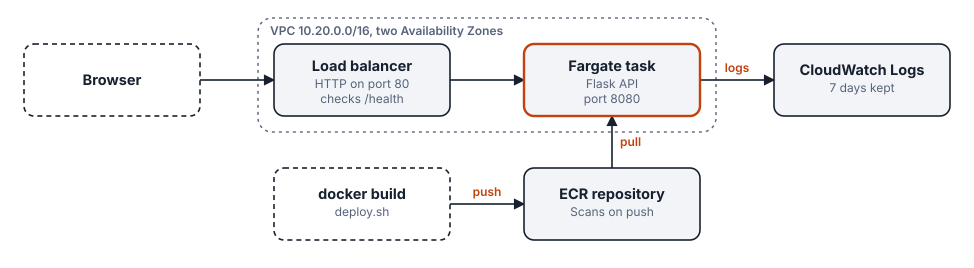

# Containerised API on ECS Fargate

A small Python web API packaged as a Docker image and run on **ECS Fargate** behind an **Application Load Balancer**. The whole environment, network included, is one **CloudFormation** template.



## What it builds

- A **Docker** image of a Flask API, running under gunicorn as a non-root user.
- An **ECR** repository that stores the image and scans it on push.
- A **VPC** with two public subnets in different Availability Zones.
- An **Application Load Balancer** that accepts HTTP from the internet and health-checks `/health`.
- An **ECS Fargate** service that runs the container with no servers to manage.
- **Security groups** so the containers accept traffic only from the load balancer.
- **CloudWatch Logs** with seven days of retention.

## Why I built it

My other projects are serverless. Most companies also run containers, so I wanted to build the standard pattern end to end: write an app, package it, push it to a registry and run it behind a load balancer.

## Deploy

Needs Docker and the AWS CLI. Both are available in AWS CloudShell.

```bash
bash deploy.sh
```

The script creates the ECR repository, builds and pushes the image, deploys the stack and prints the URL. Run it again after changing the app and ECS replaces the container with no downtime. If the new version fails its health check, the deployment circuit breaker rolls back by itself.

## Cost

The load balancer and the Fargate task are billed by the hour, roughly £1 a day in total. Remove everything when you have finished:

```bash
bash destroy.sh
```

## Test the app locally

```bash
pip install -r app/requirements.txt pytest
cd app && pytest
```

## What I learned

- The difference between the task execution role (what ECS needs to start the container) and a task role (what the app itself may do).
- Why the target group uses `ip` targets with Fargate's `awsvpc` networking.
- How health checks, minimum healthy percent and the circuit breaker combine to give a safe rolling deployment.

## What I would add next

- HTTPS on the load balancer with an ACM certificate.
- Tasks in private subnets, pulling images through VPC endpoints.
- Auto scaling on CPU, and a GitHub Actions pipeline to build and deploy on push.

---

*Part of my AWS portfolio. More at [vithu.cloud](https://vithu.cloud).*
